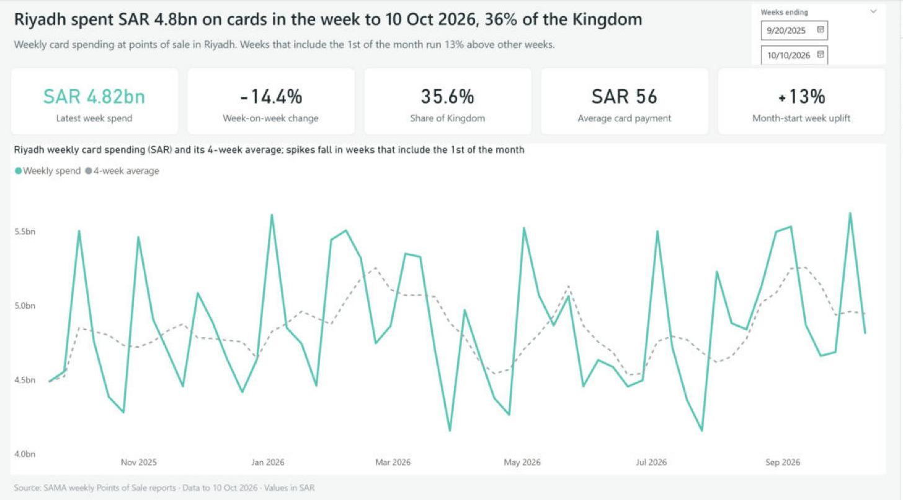
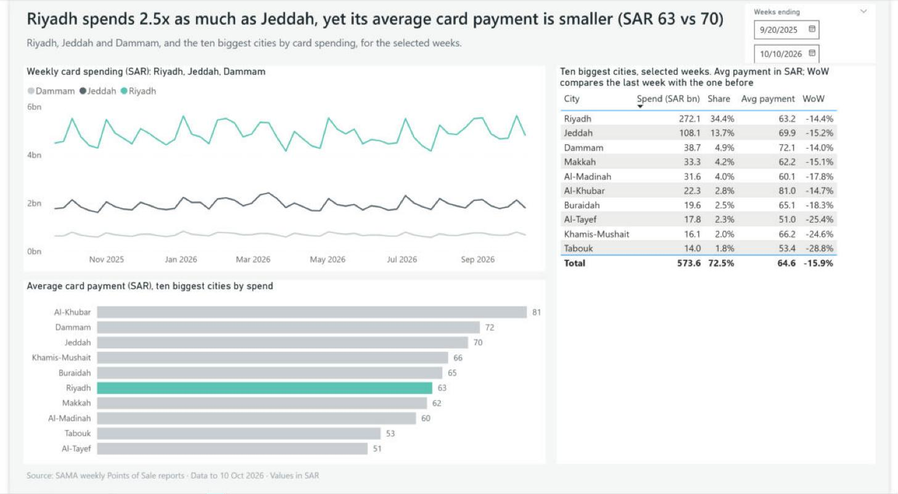
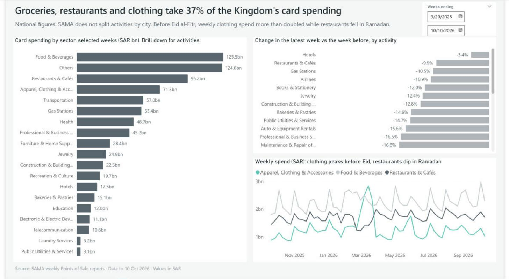

# Riyadh card spending: a weekly Power BI dashboard

How much does Riyadh spend on cards each week, how does it compare with other Saudi cities, and where does the money go? This Power BI report answers those questions from the Saudi Central Bank's (SAMA) weekly point-of-sale statistics, covering **56 weeks from 14 Sep 2025 to 10 Oct 2026**.



| Riyadh vs other cities | Where the money goes (national) |
|---|---|
|  |  |

## Findings

**1. Spending jumps in the days after payday.** In weeks that include the 1st of the month, Riyadh spends 13% more than in other weeks (17% for the Kingdom as a whole). Saudi state salaries are paid on the 27th. Weeks that contain the 27th but end before the month turns show no lift (1% below the 56-week average). Weeks that include the 1st run 9–12% above it. So the jump comes in the days after the 27th, not on the day itself. The data is weekly and has no pay dates, so this is consistent with a salary effect rather than proof of one. Month-start bills and private-sector pay cycles may also contribute.

**2. Riyadh spends 2.5 times as much as Jeddah, in smaller payments.** Riyadh took SAR 272bn, or 34% of the Kingdom's SAR 791bn in card spending over the period, against SAR 108bn for Jeddah. Its average card payment is lower: SAR 63, against SAR 70 in Jeddah and SAR 72 in Dammam. Riyadh's lead comes from making more payments, not bigger ones.

**3. Groceries, restaurants and clothing take 37% of national card spending, and Ramadan reshuffles them.** In the week before Eid al-Fitr (week ending 14 Mar 2026), clothing spending reached SAR 2.8bn, 2.4 times its normal weekly level, then fell to SAR 1.0bn after Eid. Restaurant and café spending was 24% below normal during Ramadan and rebounded to SAR 2.0bn in the week after Eid. These figures are national, because SAMA does not split activities by city.

## Data

[SAMA – Weekly Points of Sale Transactions](https://www.sama.gov.sa/en-US/Statistics/Indices/Pages/POS.aspx). Each weekly PDF has three tables covering the latest four weeks:

- **Table 1:** number and value of transactions by activity (30 activities plus a total)
- **Tables 2.1–2.2:** the same by city (61 cities, including "Others")

Values are in SAR thousands in the source. I used 15 reports, one roughly every four weeks, which together cover every week in the period with no gaps. The PDFs are not stored in this repo; download them from SAMA.

## Method

```
SAMA PDFs ──► scripts/extract_pos.py ──► data/activities.csv, data/cities.csv ──► Power BI model ──► 3 report pages
```

1. **Extract** (`scripts/extract_pos.py`, Python + pdfplumber). The script reads the text layer of each report and pulls out the activity and city rows. It converts figures from thousands to SAR and writes one row per name per week. Reports overlap by up to three weeks, and when they do, the newest report wins because SAMA sometimes revises figures. It also flags the three activity subtotals (Transportation, Health, Recreation & Culture) so they are never counted twice.
2. **Check.** For every week, the activity lines add up to SAMA's printed total, and the 61 cities add up to the same total, within SAR 6k on totals of about SAR 13bn (rounding in the source). Each subtotal matches its sub-rows to within SAR 1k.
3. **Model** (Power BI project, `.pbip`, with the semantic model in TMDL). It has two fact tables (`Cities`, `Activities`) and a weekly `Date` table built in Power Query. The Date table labels month-start weeks and the Ramadan, Eid al-Fitr, Eid al-Adha and National Day weeks, using the Umm al-Qura calendar. Both relationships are one-to-many with single-direction filtering.
4. **Measures.** 38 DAX measures live in a `_Measures` table, including:
   - spend, transactions and average payment
   - share of the Kingdom, using `REMOVEFILTERS` on City
   - week-on-week change and the 4-week rolling average, using plain date filters that work on a weekly calendar
   - latest-week versions for the KPI cards
   - text measures for the page titles, so each headline states the current finding and stays true after a refresh

## Limitations

- **Card payments at points of sale only.** Cash, bank transfers and most online purchases are not included, so this is not total consumer spending.
- **Nominal SAR, not adjusted for inflation.** Changes over the period include price changes.
- **Data to 10 Oct 2026** (week ending Saturday). SAMA publishes every Tuesday.
- **Activities are national.** The reports do not break activities down by city, so page 3 cannot be filtered to Riyadh.
- **Weekly granularity.** The weeks run Sunday to Saturday, so effects within a week, such as the exact payday, cannot be seen. Holiday labels mark the week-ending Saturday that contains the holiday.
- **Correlation, not causation.** The payday finding is a pattern in the timing, not a measured effect of salaries.

## How to refresh

1. Download the newest report from the SAMA page above. Save it in `reports/` as `POS_YYYY-MM-DD.pdf`, named after the last week-ending date it covers. One report every four weeks is enough, because each one repeats the previous four weeks.
2. Run the extractor:
   ```
   pip install -r scripts/requirements.txt
   python scripts/extract_pos.py
   ```
   It prints how many rows it found in each report and warns if a report doesn't have 31 activity rows and 61 city rows.
3. Open `RiyadhSpending.pbip` in Power BI Desktop and click **Refresh**. The headlines, cards and the "data to" date in the footer update automatically.

The model reads the CSVs from the folder in the `DataFolder` parameter, which defaults to `C:\riyadh-card-spending\data\`. If you cloned the repo somewhere else, change it under Transform data → Edit parameters.

## Repository layout

```
RiyadhSpending.pbip               Open this in Power BI Desktop
RiyadhSpending.Report/            Report pages (report.json) and theme
RiyadhSpending.SemanticModel/     Tables, relationships and DAX measures (TMDL)
scripts/extract_pos.py            PDF → CSV extractor
data/                             Extracted weekly data (activities.csv, cities.csv)
screenshots/                      The three report pages
reports/                          Put SAMA PDFs here (not committed)
```

Tools: Power BI Desktop, Power Query (M), DAX, Python (pdfplumber).
