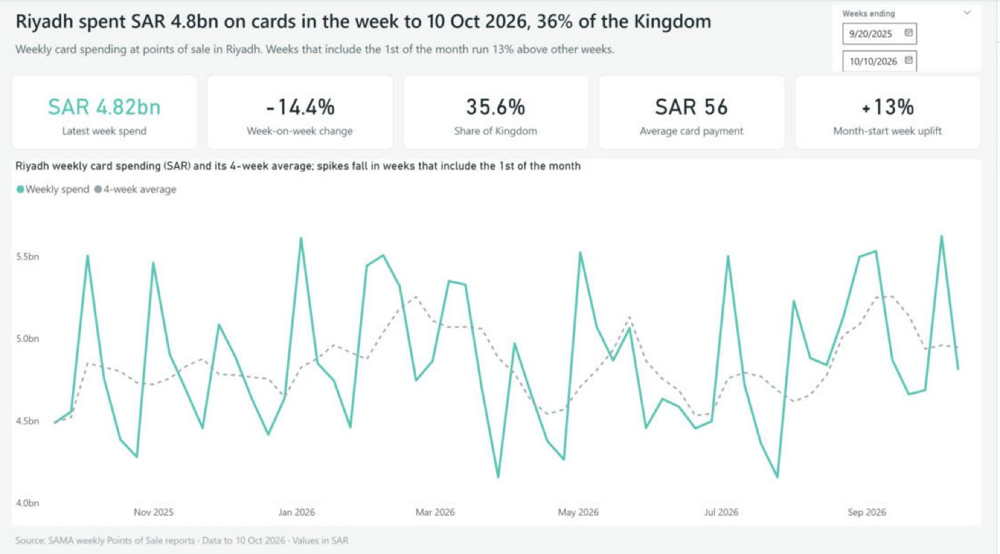
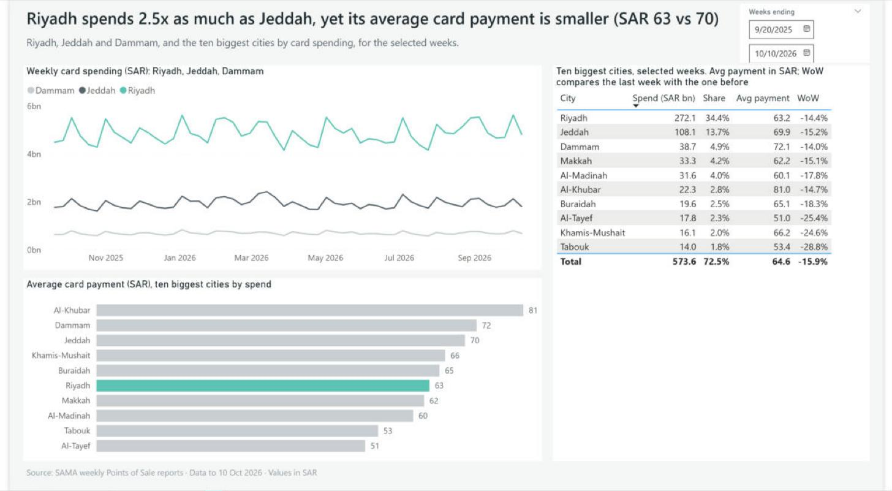
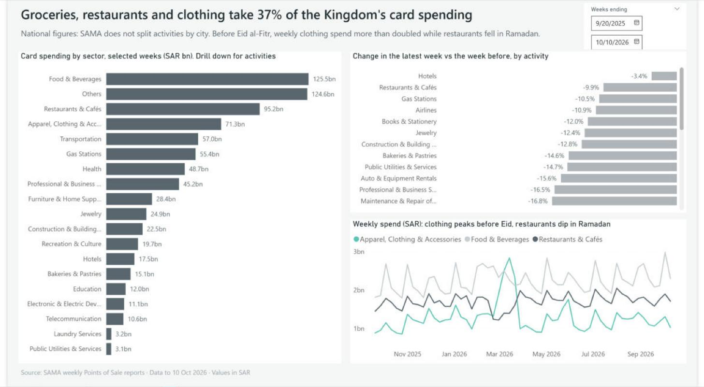

# Riyadh card spending: a weekly Power BI dashboard

How much does Riyadh spend on cards each week, how does it compare with other Saudi cities, and where does the money go? This Power BI report answers those questions from the Saudi Central Bank's (SAMA) weekly point-of-sale statistics, **from 14 Sep 2025 onwards, updated every week**: a scheduled job downloads each new SAMA report, extracts it, checks that every week still reconciles to SAMA's printed totals and commits the CSVs, and the Power BI model reads those CSVs straight from GitHub.



| Riyadh vs other cities | Where the money goes (national) |
|---|---|
|  |  |

## Findings

These are from the first 56 weeks (14 Sep 2025 to 10 Oct 2026). The report's headlines are DAX measures, so they recalculate on every refresh; the numbers below stay as written.

**1. Spending jumps in the days after payday.** In weeks that include the 1st of the month, Riyadh spends 13% more than in other weeks (17% for the Kingdom as a whole). Saudi state salaries are paid on the 27th. Weeks that contain the 27th but end before the month turns show no lift (1% below the 56-week average). Weeks that include the 1st run 9–12% above it. So the jump comes in the days after the 27th, not on the day itself. The data is weekly and has no pay dates, so this is consistent with a salary effect rather than proof of one. Month-start bills and private-sector pay cycles may also contribute.

**2. Riyadh spends 2.5 times as much as Jeddah, in smaller payments.** Riyadh took SAR 272bn, or 34% of the Kingdom's SAR 791bn in card spending over the period, against SAR 108bn for Jeddah. Its average card payment is lower: SAR 63, against SAR 70 in Jeddah and SAR 72 in Dammam. Riyadh's lead comes from making more payments, not bigger ones.

**3. Groceries, restaurants and clothing take 37% of national card spending, and Ramadan reshuffles them.** In the week before Eid al-Fitr (week ending 14 Mar 2026), clothing spending reached SAR 2.8bn, 2.4 times its normal weekly level, then fell to SAR 1.0bn after Eid. Restaurant and café spending was 24% below normal during Ramadan and rebounded to SAR 2.0bn in the week after Eid. These figures are national, because SAMA does not split activities by city.

## Data

[SAMA – Weekly Points of Sale Transactions](https://www.sama.gov.sa/en-US/Statistics/Indices/Pages/POS.aspx). Each weekly PDF has three tables covering the latest four weeks:

- **Table 1:** number and value of transactions by activity (30 activities plus a total)
- **Tables 2.1–2.2:** the same by city (61 cities, including "Others")

Values are in SAR thousands in the source. The first 56 weeks came from 15 reports, one roughly every four weeks, which together cover every week with no gaps; since then the update job adds each new report. The PDFs are not stored in this repo; download them from SAMA.

## Method

```
SAMA weekly PDF ──► scripts/update.py ──► data/activities.csv, data/cities.csv ──► GitHub ──► Power BI model (Web.Contents) ──► 3 report pages
                    (extract_pos.py + checks.py)
```

1. **Extract** (`scripts/extract_pos.py`, Python + pdfplumber). The script reads the text layer of each report and pulls out the activity and city rows. It converts figures from thousands to SAR and writes one row per name per week. Reports overlap by up to three weeks, and when they do, the newest report wins because SAMA sometimes revises figures. It also flags the three activity subtotals (Transportation, Health, Recreation & Culture) so they are never counted twice.
2. **Check** (`scripts/checks.py`, run by `pytest` and before any CSV is written). For every week, the activity lines add up to SAMA's printed total, and the 61 cities add up to the same total, and each subtotal matches its sub-rows. Because SAMA rounds every figure to the nearest thousand, the allowed gap grows with the number of figures added: from SAR 1.5k for a two-part subtotal to about SAR 11k for the 61 cities, on totals of about SAR 13bn. A misread figure is normally off by far more. The checks also fail on a missing week, a city or activity that appears or disappears, or a week-on-week swing beyond −50%/+100% (a sign the PDF was misread). If any check fails, the CSVs are left as they were.
3. **Model** (Power BI project, `.pbip`, with the semantic model in TMDL). It has two fact tables (`Cities`, `Activities`) and a weekly `Date` table built in Power Query. The Date table labels month-start weeks and the Ramadan, Eid al-Fitr, Eid al-Adha and National Day weeks, using the Umm al-Qura calendar. Both relationships are one-to-many with single-direction filtering.
4. **Measures.** 38 DAX measures live in a `_Measures` table, including:
   - spend, transactions and average payment
   - share of the Kingdom, using `REMOVEFILTERS` on City
   - week-on-week change and the 4-week rolling average, using plain date filters that work on a weekly calendar
   - latest-week versions for the KPI cards
   - text measures for the page titles, so each headline states the current finding and stays true after a refresh

## Limitations

- **Card payments at points of sale only.** Cash, bank transfers and most online purchases are not included, so this is not total consumer spending.
- **Nominal SAR, not adjusted for inflation.** Changes over the period include price changes.
- **Updated weekly, with a lag.** SAMA publishes every Tuesday; each week ends on a Saturday. The footer shows the latest week in the data.
- **Holiday labels are typed in.** The Date table marks Ramadan, both Eids and National Day from 2025 to 2027 (the 2027 Islamic dates are the predicted Umm al-Qura dates). Later holidays show as regular weeks until their dates are added in `Date.tmdl`.
- **Activities are national.** The reports do not break activities down by city, so page 3 cannot be filtered to Riyadh.
- **Weekly granularity.** The weeks run Sunday to Saturday, so effects within a week, such as the exact payday, cannot be seen. Holiday labels mark the week-ending Saturday that contains the holiday.
- **Correlation, not causation.** The payday finding is a pattern in the timing, not a measured effect of salaries.

## Keeping it updated

`scripts/update.py` does the whole weekly update:

1. reads the newest week already in `data/cities.csv`;
2. opens SAMA's POS page, downloads the PDF links on it and keeps every weekly POS report that covers later weeks (it recognises reports by the week dates in their table header, not by file name);
3. saves them in `reports/` as `POS_YYYY-MM-DD.pdf`, adds them on top of the current CSVs (the newest report wins on overlapping weeks, because SAMA sometimes revises figures) and runs the checks;
4. writes the CSVs only if every check passes.

```
pip install -r scripts/requirements.txt
python scripts/update.py                       # from SAMA's page
python scripts/update.py --pdf POS_2026-11-14.pdf   # or from a report you downloaded
pytest                                         # the checks, on the committed data
```

**Where it runs.** `sama.gov.sa` only answers connections from Saudi Arabia, so the update has to run from a Saudi internet connection.

- **GitHub Actions** (`.github/workflows/update.yml`) runs Tuesday to Friday at 06:00 Riyadh and on every push. It runs the tests, tries SAMA, and commits new CSVs if it gets through. If SAMA refuses GitHub's servers, the run still passes while the newest week is at most 21 days old, and fails (GitHub emails the owner) once the data is older than that. A run can also be started by hand with direct PDF URLs.
- **This PC, weekly** (`scripts/run_weekly.ps1`): pulls the repo, runs `update.py` and pushes new CSVs; GitHub then re-runs the tests on the push. To schedule it for Wednesdays at 20:00 (Windows Task Scheduler):

  ```
  schtasks /Create /TN "Riyadh card spending update" /SC WEEKLY /D WED /ST 20:00 /TR "powershell -NoProfile -ExecutionPolicy Bypass -File \"C:\path\to\riyadh-card-spending\scripts\run_weekly.ps1\""
  ```

  The PC must be on and off any VPN at that time. The log of the last run is `reports/last-run.log`.

**Power BI.** The model reads the CSVs from the `DataFolder` parameter, which points at this repo's raw files on GitHub (`https://raw.githubusercontent.com/khaledbinkhunein/riyadh-card-spending/main/data/`), so a refresh needs no local copy. The first time, Power BI Desktop asks how to sign in to `raw.githubusercontent.com`: choose **Anonymous**. To use local files instead, set `DataFolder` to a folder path and change `Web.Contents` to `File.Contents` in the three table queries. Open `RiyadhSpending.pbip` in Power BI Desktop and click **Refresh**; the headlines, cards and the "data to" date in the footer update automatically.

## Repository layout

```
RiyadhSpending.pbip               Open this in Power BI Desktop
RiyadhSpending.Report/            Report pages (report.json) and theme
RiyadhSpending.SemanticModel/     Tables, relationships and DAX measures (TMDL)
scripts/update.py                 Weekly update: fetch new SAMA reports, extract, check, write CSVs
scripts/extract_pos.py            PDF → CSV extractor (rebuilds data/ from every PDF in reports/)
scripts/checks.py                 Reconciliation checks used by the update and the tests
scripts/run_weekly.ps1            Weekly update from a Windows PC, for Task Scheduler
tests/                            pytest: the committed data passes every check; the checks catch bad data
.github/workflows/update.yml      Scheduled update and tests on GitHub Actions
data/                             Extracted weekly data (activities.csv, cities.csv)
screenshots/                      The three report pages
reports/                          Put SAMA PDFs here (not committed)
```

Tools: Power BI Desktop, Power Query (M), DAX, Python (pdfplumber, pytest), GitHub Actions.
